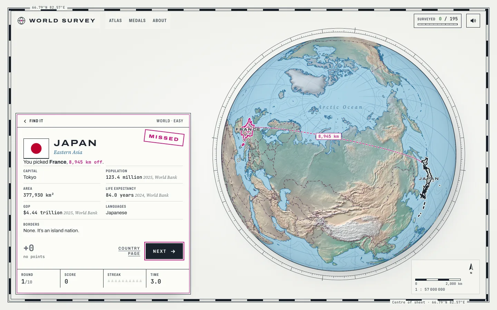
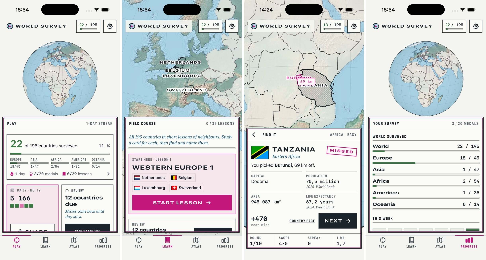

# World Survey

A geography game you play on a 3D relief globe. Find countries, pin capitals, name flags, compare numbers, and watch your own map print in colour as you learn it.

- **Play it:** https://geography.aimantas.com
- **Why it's open source, and what happened when I shipped it:** https://aimantas.com/writing/world-survey-open-source/
- **How I built it:** https://aimantas.com/writing/world-survey-3d-geography-game/



This repository is the whole thing: the web game, the native iPhone app that's in TestFlight now, the data pipeline that builds the country table, and the generator for the site's 600-odd static country, list and comparison pages. Take it apart and make your own map game. If you build something with it, I'd like to see it.

## What's inside

| Part | Where | Built with |
| --- | --- | --- |
| Web game | `index.html`, `styles.css`, `src/` | Plain ES modules and three.js r170, no bundler, no framework. Runs from any static host |
| Globe engine | `src/globe/` | A displaced relief sphere with crisp vector line work, picking by point-in-polygon, flights, pins, arcs, labels |
| Game rules | `src/game/` | Modes, scoring, the daily seed, the 39-lesson field course, spaced review, medals, local progress |
| iPhone app | `ios/` | SwiftUI and SceneKit, reusing the same data, course and scoring. See [ios/README.md](ios/README.md) |
| Data | `data/` | 195 playable states and 47 territories with capitals, borders, population, GDP and more; 1:50m outlines |
| Data tools | `tools/` | Node scripts that fetch the sources, build `data/` and the relief rasters, and check them. See [tools/README.md](tools/README.md) |
| Static pages | `tools/encyclopedia/`, `tools/reference/`, `tools/seo/` | One page per country, ranked lists, neighbour comparisons, sitemap, llms.txt, share images |



## Run it

The web game needs nothing but Python 3 to serve it:

```bash
python3 serve.py
```

Then open http://127.0.0.1:4462. Every screen has its own URL (`/play/find/europe/`, `/learn/`, `/atlas/peru/`).

The production build copies an allowlist into `dist/` and runs the page generators, which need Node 20 or later:

```bash
cd tools && npm ci && cd ..
python3 build.py
python3 serve.py --dist
```

The iPhone app needs Xcode 26 and [XcodeGen](https://github.com/yonaskolb/XcodeGen):

```bash
cd ios
xcodegen generate
open WorldSurvey.xcodeproj
```

Set your own team and bundle ID before running it on a phone. The simulator needs neither.

## Make your own game

The pieces are deliberately separate, so most new games change one layer and leave the others alone.

**A new question type.** Modes are listed in `src/game/modes.js`. A round is built in `src/ui/play.js` (`build()`), answered on the globe (`submitCountry`, `submitPoint`) or from options (`submitChoice`), scored in `src/game/scoring.js` and revealed by `reveal()`. Copy the closest mode and change the prompt and the answer check.

**A different subject on the same map.** Every country carries its capital, population, area, GDP, life expectancy, borders, languages and currencies (`data/countries.json`, documented in [docs/ARCHITECTURE.md](docs/ARCHITECTURE.md)). Higher or lower compares any numeric field: add one to `STATS` in `src/game/questions.js`. A languages quiz or a currencies quiz is a new mode over fields that are already there.

**A different map.** The globe takes any TopoJSON with an `iso3` property per feature. Swap `data/world.json` for US states, provinces or historical borders, rebuild the table with `tools/build-countries.mjs` as a starting point, and the picking, highlights and flights keep working.

**A different look.** The art direction is written down in [docs/DESIGN.md](docs/DESIGN.md): the paper sheet, ink, magenta overprint, the stamps. Colours live in `styles.css` and the globe's shader in `src/globe/shaders.js` and `src/globe/surface.js`. The relief texture is `assets/relief-*.webp`.

**Your own domain.** Search for `geography.aimantas.com` (about ten places: `index.html`, `src/routes.js`, `src/game/daily.js`, `build.py`, `tools/encyclopedia/lib.mjs`, `tools/reference/`, `tools/seo/`). Analytics is off until you fill in `assets/analytics.js`; the About screen's sentence about analytics lives in `src/ui/pages.js`.

Some games I'd like to see built from this: US states and capitals, rivers and mountain ranges, borders through history, "which country speaks it", a flag quiz for a classroom.

## How it fits together

[docs/ARCHITECTURE.md](docs/ARCHITECTURE.md) covers the data contract, the globe engine's API, scoring, the daily seed and how the web game and the iPhone app share their rules.

## Licence

The code is MIT ([LICENSE](LICENSE)). The data and imagery come from open sources with their own terms, and the country tables are a derived database under the Open Database License: see [NOTICE.md](NOTICE.md) before you reuse `data/` or `ios/WorldSurvey/Resources/`.

## Feedback

The iPhone app is in TestFlight and I'm still deciding what goes into the first App Store version. Open an issue with what you'd change, what's missing, or what you built. Or find me on X at [@aimantasai](https://x.com/aimantasai).

More of what I build: https://aimantas.com
